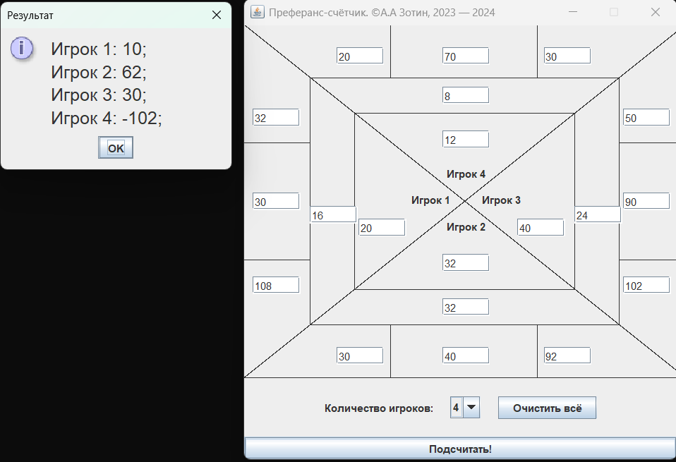

# Preferans score calculator
[🇷🇺 Русский](#ru) | [🇩🇪 Deutsch](#de)

# RU

## Что это?

Это программа, которая подсчитывает результат игры в преферанс. 
Поддерживается подсчёт для двух, трёх или четырёх игроков.

### По какому алгоритму производится подсчёт?

1. Из самой большой "пули" поочерёдно вычитаются остальные, 
разница дописывается игрокам в "гору" в удвоенном размере.
2. Считаются "горы" между всеми парами игроков.
Бóльшая вычитается из меньшей и эта разность — проигрыш
игрока с большей горой. Она умножается на 10 и делится на количество
игроков, после чего вычитается из вистов игрока.
Второму игроку это число, наоборот, прибавляется.
3. Подсчитываются висты между игроками. И те, 
которые были написаны во время
игры, и те, которые были получены с горы.
4. Висты каждого игрока алгебраически суммируются.

## Как использовать?

Нужно скачать и запустить исполняемый Jar-файл (он находится на вкладке Releases).
Для запуска требуется Java 22+.

## Пример подсчёта

# DE

## Was ist das?

Das ist ein Programm, das die Ergebnisse einer Preference-Partie berechnet.
Es wird die Berechnung für zwei, drei oder vier Spieler unterstützt.

### Welcher Algorithmus wird benutzt?

1. Von der größten "Kugel" werden nacheinander alle anderen subtrahiert, die Differenz wird den Spielern 
mit zwei multipliziert in den "Berg" geschrieben.
2. Die "Berge" werden paarweise berechnet. Der Verlust des Spielers mit dem größeren Berg ist die Differenz zwischen beiden Bergen.
Er wird mit zehn multipliziert und dann durch die Anzahl der Spieler dividiert. 
Das Ergebnis wird danach von den Whists des Spielers subtrahiert und zu den Whists des anderen Spielers addiert.
3. Die Whists (sowohl während des Spieles notierte als auch aus dem Berg konvertierte) werden berechnet. 
4. Die Whists jedes Spielers werden algebraisch summiert.

## Wie kann man das benutzen?

Laden Sie die Jar-Datei (sie ist auf der Releases-Seite zu finden) herunter und starten Sie sie.
Für den Start wird Java 22+ benötigt.

## Beispiel der Berechnung

 